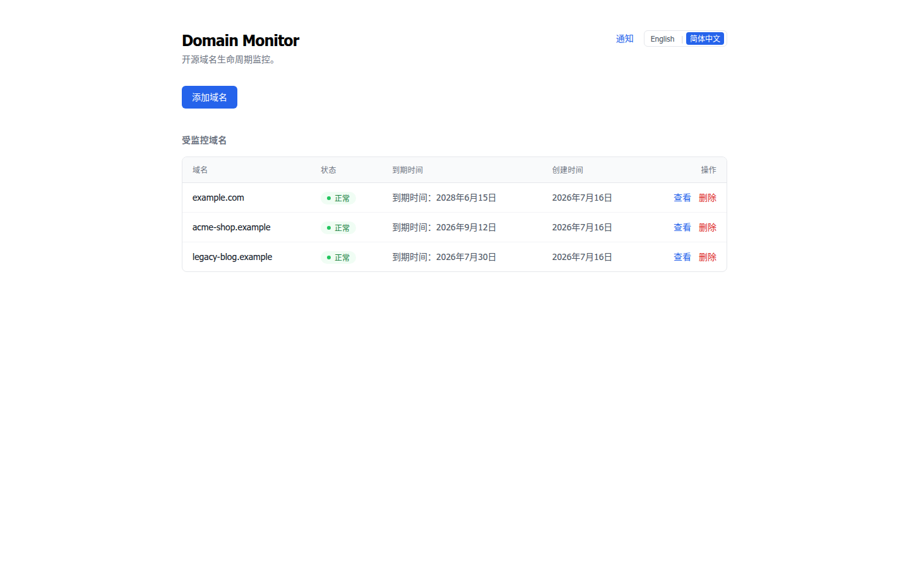
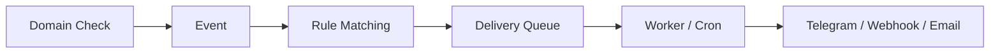
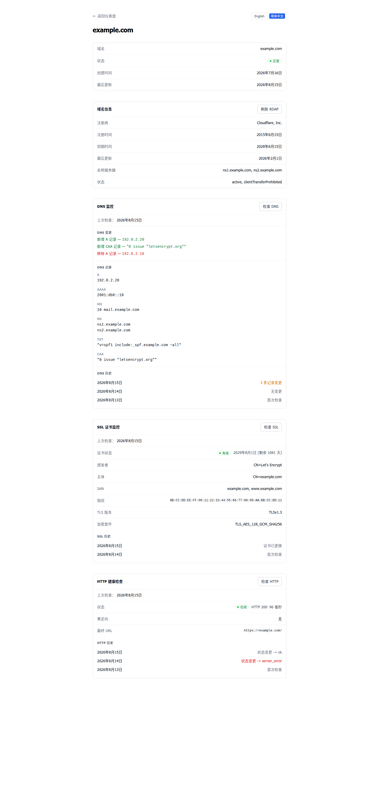
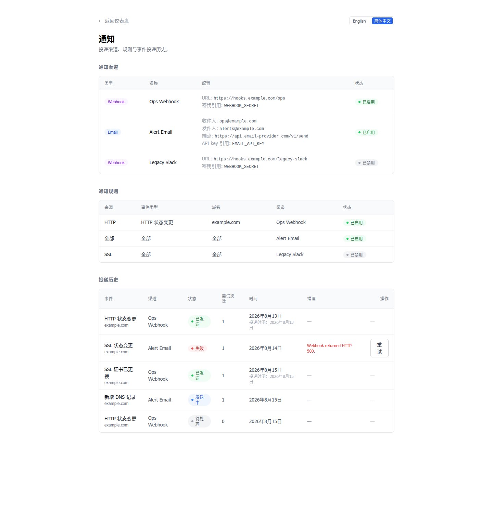

# Domain Monitor

[English](README.md) | [简体中文](README.zh-CN.md)

**🛰️ 自托管域名监控：RDAP、DNS、SSL 与 HTTP，一站搞定。**

[](https://github.com/hxx0611/Domain-Monitor/actions/workflows/ci.yml)
[](LICENSE)
[](https://github.com/hxx0611/Domain-Monitor/releases)

把你的域名管起来：跟踪注册信息、发现 DNS 和 SSL 的变化、捕捉 HTTP 故障——变化一发生就通知你。🔔

- ⚡ **事件驱动通知** —— 变化变成事件，事件变成通知
- 📨 **Telegram / Webhook / Email** —— 直接投递到你常用的工具里
- 📅 **手动到期与提醒** —— 手动设置到期时间（RDAP 或 manual 来源）、登记平台、安排到期提醒
- 🚚 **Delivery Worker** —— 一次性 CLI，配个 cron 就能跑，没有 daemon 要伺候
- 🔐 **管理员认证** —— 初始化向导、登录、一次性恢复码
- 🌏 **English / 简体中文** 界面



> 📸 截图来自较早的版本；现在的 UI 已经加上管理员认证和 Telegram 渠道了。

## 🤔 为什么选 Domain-Monitor？

域名从来不是"在线 / 离线"这么简单。真正值得盯的，是中间那些变化：

- 🧭 **DNS 变化** —— 记录新增、删除或修改（A / AAAA / CNAME / MX / NS / TXT / CAA）
- 🔒 **SSL 变化** —— 证书快到期了、被换了、或者和主机名对不上
- 🌐 **HTTP 故障 / 恢复** —— 宕机、状态码变化、重定向漂移
- 🪪 **注册信息** —— 注册商、到期时间、名称服务器、RDAP 状态

Domain Monitor 把这些变化变成 **事件**，按你的 **规则** 匹配，再以 **通知** 的形式送到你手上——事情*一变*你就知道，而不是*坏了*才发现。🎯

## ⚡ 快速开始

```bash
git clone https://github.com/hxx0611/Domain-Monitor.git
cd Domain-Monitor
pnpm install
cp .env.example .env
pnpm dev
```

然后打开 [http://localhost:3000](http://localhost:3000)，搞定。🎉

你需要：**Node.js 22 LTS 或更新版本**（推荐 22 LTS；24 / 26 已纳入 CI 兼容性测试）和 [pnpm](https://pnpm.io/)。Linux、macOS、Windows 都能跑。better-sqlite3 自带预编译二进制，直接 `pnpm install` 就行，不需要 Python 或 C++ 构建工具链。👌

> 👇 **这个项目有两种跑法——先选一种，别把两套命令混着用：**
>
> - 🖥️ **Option A — 本地 / Node**（上面就是）：`better-sqlite3` + SQLite，`pnpm dev` / `pnpm build` / `pnpm start`，数据库存在本地文件 `data/domain-monitor.db`。
> - ☁️ **Option B — Cloudflare Production**（下面整节）：Cloudflare Worker + OpenNext + D1，`custom-worker.ts` + `scheduled()`，数据库在云端 D1。**如果你的目标是部署到 Cloudflare，就继续往下读，别用上面的本地命令。**

---

## Cloudflare Production 部署（Option B）

> 🧭 这一节专为**从没碰过 Cloudflare Workers / D1 / OpenNext 的新手**写的。照着顺序一步一步来，别跳步。
> 走完之后，你就有一套**完全属于自己**的 Cloudflare 部署（自己的 Worker、自己的 D1、自己的域名）——不会碰任何人的生产资源。🙌

> 🚨🚨🚨 **动手前必读（安全警告）** 🚨🚨🚨
>
> 1. 🚫 **绝对不要直接使用仓库 `wrangler.prod.jsonc` 里的 `database_id`。** 那是**作者生产环境的数据库 ID**——你的账号里根本没有它，带着它部署会失败；万一你在作者账号上执行，还可能碰到作者的生产数据。**你必须创建自己的 D1，并把 `database_id` 换成你自己的**（见第 3 步）。
> 2. ⚠️ **如果你的 Cloudflare 账号里已经存在名为 `domain-monitor` 的 Worker 或 D1**（比如你之前部署过），`wrangler d1 create domain-monitor` 会冲突，`wrangler deploy` 甚至会**覆盖你已有的同名 Worker**。请改用唯一名称，例如 `domain-monitor-yourname`，并保证 Worker 名、D1 名、`wrangler.prod.jsonc` 里的 `name`/`database_name` 和下面所有命令**全都一致**。
> 3. 🔒 **不要对不属于你的 Worker 执行 `wrangler secret put`、`wrangler deploy` 或其他任何修改操作。** 动手前先确认当前的 Cloudflare 账号是你自己的。

### 0. 前置条件 ✅

先把这些备齐：

- 🌩️ 一个 [Cloudflare](https://dash.cloudflare.com/) 账号（免费版就够用）
- 🌍 一个域名（可选但推荐；没有也能先用 `*.workers.dev` 临时域名验证）
- 📦 Node.js 22+ 与 **pnpm 10.14+（推荐 11；仓库 lockfile 为 v9，且 `pnpm-workspace.yaml` 的 `allowBuilds` 语法需要 pnpm ≥10.14，pnpm 9 会安装失败）**
- 💻 一台能跑 `bash` 的机器；Windows 用户请看第 7 节的 PowerShell 构建命令

### 1. 克隆并安装依赖 🛠️

```bash
git clone https://github.com/hxx0611/Domain-Monitor.git
cd Domain-Monitor
pnpm install
```

Wrangler（Cloudflare 官方 CLI）和 OpenNext Cloudflare 适配器**不是项目的正式依赖**，要单独装成开发依赖：

```bash
pnpm add -D wrangler @opennextjs/cloudflare
```

> ⚠️ **pnpm 10.14+（推荐 11）需要放行 workerd 的构建脚本**：wrangler 依赖 `workerd`，pnpm 出于安全默认拦截依赖的 postinstall 脚本，安装时可能提示 `ERR_PNPM_IGNORED_BUILDS: Ignored build scripts: workerd`。不放行的话，后面的 OpenNext build 会失败。若你的 pnpm 低于 10.14，请先用 `corepack use pnpm@11`（或 `npm i -g pnpm@11`）升级，否则 `allowBuilds`/`approve-builds` 不可用。
>
> **推荐方法（最简单，不会改坏文件）：运行**
>
> ```bash
> pnpm approve-builds
> ```
>
> 在交互提示里选 `workerd` 并放行，然后重跑 `pnpm install`。👍
>
> **备选方法（手动编辑 `pnpm-workspace.yaml`）**：
>
> 1. 打开 `pnpm-workspace.yaml`，看看 pnpm 是不是已经插入过占位行（比如 `workerd: set this to true or false`）；
> 2. **已经有 `workerd` 条目：直接把值改成 `workerd: true`，绝对不要再加第二行**；
> 3. **没有 `workerd` 条目：在 `allowBuilds:` 下追加一行 `workerd: true`**（注意缩进和已有条目一致）。
>
> ⚠️ **不要**在同一个 YAML 文件里重复添加 `allowBuilds:` 或 `workerd:`——重复 key 会让 `pnpm install` 报 `duplicated mapping key`。改完再跑一次 `pnpm install`，确认警告消失。

快速验证一下：

```bash
pnpm exec wrangler --version            # 应输出 4.x
pnpm exec opennextjs-cloudflare --help  # 应打印帮助信息
```

### 2. 创建 Cloudflare API Token 🔑

去 Cloudflare Dashboard → **My Profile → API Tokens → Create Token**，用 **"Edit Cloudflare Workers"** 模板（或者自己建一个自定义 token），至少给这些权限（全部 **Edit**）：

| 资源 | 权限 | 用途 |
|---|---|---|
| Account → Workers Scripts | Edit | 上传/更新 Worker |
| Account → D1 | Edit | 创建/管理 D1 数据库 |
| Zone → Workers Routes（可选） | Edit | 绑定自定义域名 |
| Zone → Zone（可选） | Read | 读取你的域名区域 |

然后把 token 导出成环境变量（⚠️ **千万别写进仓库、`.env`、`wrangler.prod.jsonc` 或任何配置文件**）：

```bash
export CLOUDFLARE_API_TOKEN=你的token
export CLOUDFLARE_ACCOUNT_ID=你的账号id   # Dashboard 右下角能找到
```

（或使用 `wrangler login` 浏览器登录，二选一。）

### 3. 创建你自己的 D1 数据库 ⚠️ 最重要

> ⚠️ **如果你的账号里已经有名为 `domain-monitor` 的 D1 或 Worker，改用唯一名称**，比如 `domain-monitor-yourname`（`yourname` 换成你自己的标识）。**千万不要覆盖不属于你的资源。** 下面所有命令里的 `domain-monitor` 都要换成你的唯一名称。

```bash
pnpm exec wrangler d1 create domain-monitor
```

输出大概长这样：

```
✅ Successfully created DB 'domain-monitor' in region APAC
Created your new D1 database.
[[d1_databases]]
binding = "DB"
database_name = "domain-monitor"
database_id = "<YOUR_DATABASE_ID>"
```

> ⚠️ **绝对不要使用仓库 `wrangler.prod.jsonc` 里已有的 `database_id`**——它属于作者的生产环境，你的账号里根本没有，直接部署会失败；更糟的是，万一你在作者账号上操作，可能影响作者的生产数据。**把上面输出里的 `<YOUR_DATABASE_ID>` 记下来。**

接着打开 `wrangler.prod.jsonc`，把 `d1_databases[0].database_id` 换成你自己的 `<YOUR_DATABASE_ID>`（`binding = "DB"` 保持不变）。**如果你用了唯一名称**（比如 `domain-monitor-yourname`），把 `d1_databases[0].database_name` 和顶部的 `"name"` 也改成同一个——**Worker 名、D1 名、配置文件、后续所有命令，必须完全一致**。✅

### 4. 执行 D1 migrations 📜

> 这条命令**必须在仓库根目录**执行（`cd Domain-Monitor` 之后），并且**必须带 `--config wrangler.prod.jsonc`**——仓库根目录没有默认的 `wrangler.jsonc`，不带 `--config` 会报 `No configuration file found`。

```bash
pnpm exec wrangler d1 migrations apply domain-monitor --remote --config wrangler.prod.jsonc
```

- 这是把 `src/db/migrations/` 应用到**你刚创建的** D1 数据库（`--remote` = 云端）。
- 应该能看到 0000–0007 全部 applied。
- ⚠️ **`pnpm db:migrate` 是本地 SQLite migration，替代不了这一步**；它碰不到 Cloudflare D1。

### 5. 设置 Secrets（ENCRYPTION_KEY / SESSION_SECRET）🔐

两个密钥：

- `ENCRYPTION_KEY`：加密 Telegram token 等敏感数据（AES-256-GCM）。⚠️ **一旦设置，弄丢了加密过的数据就找不回来了。**
- `SESSION_SECRET`：登录会话（cookie）签名。

> 在仓库根目录执行，**必须带 `--config wrangler.prod.jsonc`**，确保 secret 写进**你自己的** Worker（就是第 3 步你改好名字的那个）。

```bash
openssl rand -hex 32 | pnpm exec wrangler secret put ENCRYPTION_KEY --config wrangler.prod.jsonc
openssl rand -hex 32 | pnpm exec wrangler secret put SESSION_SECRET --config wrangler.prod.jsonc
```

Windows PowerShell 没有 `openssl`？先生成 64 位 hex，再在提示时粘贴：

```powershell
-join ([System.Security.Cryptography.RandomNumberGenerator]::GetBytes(32) | ForEach-Object { $_.ToString("x2") })
```

> 每条命令会提示你输入 secret，直接粘贴上面生成的 64 位 hex 就行。这些值**永远不会进 git、不会进 README、不会进 `.env`、不会进任何配置文件**——它们只待在 Cloudflare Secrets 里。🗝️
>
> ⚠️ **绝不要对不属于你的 Worker 执行 `wrangler secret put`**——它会把 secret 写进那个 Worker 并覆盖已有值。执行前确认 `wrangler.prod.jsonc` 里的 `"name"` 是你自己的 Worker 名。

### 6. 清理旧 build 缓存 🧹

**每次 Cloudflare 构建前**都来一发（原因见第 8 节）：

```bash
rm -rf .next .open-next
```

Windows PowerShell：

```powershell
Remove-Item -Recurse -Force .next,.open-next
```

### 7. 构建 OpenNext（Cloudflare）产物 🏗️

```bash
OPENNEXT_CLOUDFLARE=1 SKIP_WRANGLER_CONFIG_CHECK=yes pnpm exec opennextjs-cloudflare build
```

Windows PowerShell（同样的构建命令，环境变量用 `$env:` 设置）：

```powershell
$env:OPENNEXT_CLOUDFLARE="1"
$env:SKIP_WRANGLER_CONFIG_CHECK="yes"
pnpm exec opennextjs-cloudflare build
Remove-Item Env:OPENNEXT_CLOUDFLARE,Env:SKIP_WRANGLER_CONFIG_CHECK
```

这都在干嘛：

- **`OPENNEXT_CLOUDFLARE=1` 不是可选项** 🚫：它让 Next.js 用 `tsconfig.cf.json` 的 stub 别名（把 `@/db` 指向 Cloudflare stub），并让 webpack 把 `@/db` / `@/db/node-singleton` 重定向到 stub——这样 **better-sqlite3 等 Node/SQLite 依赖绝不会进入 Cloudflare Worker bundle**。不设它，构建会混进 Node/SQLite 运行时代码，部署后 Worker 直接报错。
- `SKIP_WRANGLER_CONFIG_CHECK=yes`：仓库根目录只有 `wrangler.prod.jsonc`（OpenNext 默认只认根目录的 `wrangler.jsonc`/`wrangler.toml`），所以跳过它自己的配置存在性检查。**这不影响 `wrangler deploy`**（deploy 会显式用 `--config wrangler.prod.jsonc`）。
- 成功标志：`.open-next/worker.js` 和 `.open-next/assets/`（含 `BUILD_ID`）存在。✅

> 为什么必须先清缓存：如果你之前跑过不带 `OPENNEXT_CLOUDFLARE=1` 的普通 `pnpm build`，`.next` 缓存里可能残留 Node/SQLite 路径的构建结果，直接复用会污染 Cloudflare 产物。**先把 `.next .open-next` 删掉再构建**，便宜又靠谱的保险。

### 8. dry-run / bundle 安全验证（推荐）🔍

```bash
pnpm exec wrangler deploy --config wrangler.prod.jsonc --dry-run
```

- 成功标志：输出里有 `Read N files from the assets directory .open-next/assets`、`env.DB` / `env.ASSETS` bindings，以及 `--dry-run: exiting now`。
- 想再稳一点（可选）：导出最终 bundle，确认里面没有 SQLite 运行时：

```bash
pnpm exec wrangler deploy --config wrangler.prod.jsonc --dry-run --outdir /tmp/dm-bundle
grep -c "new Database(" /tmp/dm-bundle/custom-worker.js   # 期望 0
grep -c "better-sqlite3" /tmp/dm-bundle/custom-worker.js  # 只允许出现在 drizzle-orm 的包名路径里
```

> Cloudflare 部署用的是 **D1**，不是 better-sqlite3/SQLite。bundle 里不能有 `new Database(` / `DATABASE_URL` / `node:sqlite` 这些运行时引用。🚫

### 9. 部署 Worker 🚀

```bash
pnpm exec wrangler deploy --config wrangler.prod.jsonc
```

- 顺序别搞反：**先完成第 7 步构建**（生成 `.open-next/assets`）再 deploy；否则 `assets.directory .open-next/assets does not exist` 直接失败。
- 输出会显示 `Uploaded domain-monitor` / `Deployed domain-monitor`，外加版本号。🎉
- ⚠️ **部署前最后一道确认**：`wrangler.prod.jsonc` 顶部的 `"name"` 必须是**你自己的 Worker 名**（默认 `domain-monitor`，用了唯一名称就是 `domain-monitor-yourname`）。`wrangler deploy` 会**上传/覆盖**这个名字的 Worker——**绝不要**覆盖别人的同名 Worker。

### 10. Cron 定时触发 ⏰

`wrangler.prod.jsonc` 已经内置了：

```jsonc
"triggers": { "crons": ["0 * * * *"] }   // 每小时整点
```

- 部署完成后，Cron **由 Cloudflare 自动托管**——不用再配 Linux cron。😌
- Cloudflare production 的入口是 Worker 的 `scheduled()`（经 D1 调 `runOnce`），**不是**本地的 `pnpm worker`。

### 11. 绑定域名 🌐

- **先验证**：打开 `https://domain-monitor.<你的workers子域>.workers.dev` 应该能访问（用了唯一名称就是 `https://domain-monitor-yourname.<你的workers子域>.workers.dev`）。
- **再绑自定义域名**（可选，推荐）：Dashboard → Workers & Pages → 你的 Worker → **Settings → Domains & Routes → Add → Custom Domain**，输入 `monitor.<你的域名>`，确认自动配好的 DNS。

- ⚠️ **别照抄作者的域名**（比如 `monitor.snooze.eu.cc`）——用你自己的。🚫

### 12. 首次访问初始化（/setup）👋

打开 `https://monitor.<你的域名>`（或 workers.dev 地址）：

1. 未配置时会自动跳到 `/setup` → 创建管理员账号
2. 💾 **保存好 recovery code**——它是重置密码的唯一凭据，只显示一次
3. 登录
4. 📨 **Notifications → 添加 Telegram channel**：粘贴 Bot Token，系统会用 Telegram `getMe` 验证，通过后以 AES-256-GCM 加密存储
5. 🔒 **Telegram Bot Token 不用放进 `.env`**——它只存在于你的 D1 数据库里（加密后）

### 13. 部署成功 Checklist ✅

- [ ] Git clone 完成
- [ ] `pnpm install` 完成
- [ ] `pnpm exec wrangler --version` 可用
- [ ] `pnpm exec opennextjs-cloudflare --help` 可用
- [ ] 自己的 D1 已创建
- [ ] `wrangler.prod.jsonc` 的 `database_id` 已是**你自己的** `<YOUR_DATABASE_ID>`
- [ ] `wrangler d1 migrations apply --remote --config wrangler.prod.jsonc` 成功（0000–0007）
- [ ] `ENCRYPTION_KEY` 已配置（`wrangler secret put`）
- [ ] `SESSION_SECRET` 已配置（`wrangler secret put`）
- [ ] `.next` / `.open-next` 已清理
- [ ] `OPENNEXT_CLOUDFLARE=1` 构建成功
- [ ] `.open-next/worker.js` 存在
- [ ] `.open-next/assets/` 存在
- [ ] `wrangler deploy --dry-run` 成功
- [ ] Worker 已部署
- [ ] Cron 已配置（`0 * * * *`，Cloudflare 托管）
- [ ] 自定义域名可访问（或 workers.dev 可访问）
- [ ] `/setup` 可访问
- [ ] 管理员已创建
- [ ] Recovery code 已保存
- [ ] Telegram channel 已验证

🎉 全部打勾？恭喜，部署完成，收工！

---

[回到顶部](#domain-monitor)

## ✨ 功能

### 🧠 域名情报（Domain Intelligence）

- 所有被监控域名集中管理——自托管本地存储（SQLite）
- 创建域名时自动 RDAP 查询：注册商、到期时间、名称服务器、RDAP 状态（IANA bootstrap，590+ TLD）
- 🔎 **ownership 感知的 RDAP fallback**：子域名没有独立 RDAP object 时，查询回退到注册域并报告 `ownership = parent`——父域的到期时间/注册商/名称服务器**绝不会**写进子域名自己的字段，UI 里子域名的注册信息显示 `Unavailable`
- ✋ **手动到期**（来源 = `manual`）：注册日期、到期日期、登记平台、管理 URL 全部手动填——专治 RDAP 数据不可靠、缺失、或者你就是不想那么显示的域名。手动日期**绝不会**被 RDAP 刷新覆盖（刷新只更新 RDAP 元数据，或对 `no-object` / parent 结果清空）
- ⏳ **到期提醒**：按域名配提醒规则（比如到期前 30 天）；通知 Worker 负责评估并发出 `expiration_reminder` 事件（当前可用性说明见下方 **Delivery Worker**）
- 🧹 域名规范化与校验（喂给它 `https://example.com/path`，存下的是 `example.com`）
- 🔄 随时手动刷新 RDAP

### 🧭 DNS 监控

- 基于 DNS-over-HTTPS（Cloudflare DoH，解析器可用 `DNS_DOH_ENDPOINT` 换）
- 跟踪 A / AAAA / CNAME / MX / NS / TXT / CAA 记录
- 历史快照 + 新增/移除记录检测（只有 TTL 变化会被忽略）
- 🛡️ 原子化失败检查处理——部分失败绝不会把旧数据删了

### 🔒 SSL 监控

- TLS 证书检查（Node.js 原生 TLS）
- 到期跟踪：有效 / 即将到期 / 已过期
- 主机名不匹配检测（SAN 与查询域名对比）
- 证书指纹 / 替换检测，TLS 版本与加密套件信息

### 🌐 HTTP 监控

- HTTP 状态分类 + 响应时间跟踪
- 重定向跟踪（次数和最终 URL）
- 连接失败检测（down）
- 每次检查都有历史

### 🔔 通知系统

- DNS / SSL / HTTP 检查产生的域名生命周期事件
- 渠道：**Telegram**、**Email API**、**Webhook**
- 🧪 **测试通知**（v0.8.4）：管理员在每个 Telegram channel 上点 `Send Test Notification`——走的正是现有的 factory/sender/加密 secret 管道，不多不少恰好一个事件 + 一个投递 + 一条消息，明确标注 `Test Notification`，绝不经过规则或到期逻辑
- 🌏 **渠道级通知语言**（v0.8.6）：渠道编辑表单里选 `language`（`en` / `zh-CN`）；消息模板和事件标签跟着本地化，机器状态值保持规范不变
- 🕐 **渠道级通知时区**（v0.8.7）：渠道编辑表单里选 IANA `timezone`（默认 `UTC`）；Telegram 消息时间戳用 `Intl.DateTimeFormat` 渲染成 `YYYY-MM-DD HH:mm:ss (Timezone)`（支持 DST），内部存储仍是 UTC
- 基于规则的投递匹配（全局或按域名的规则，可按 source / event type 过滤——含 `expiration_reminder`）
- 🎛️ 通知配置 UI——渠道 CRUD（创建 / 编辑 / 启停 / 删除）、规则 CRUD
- 🔐 Telegram bot token 服务端 `getMe` 验证 + **AES-256-GCM 加密存储**（`ENCRYPTION_KEY`），保留 legacy `TELEGRAM_BOT_TOKEN` 环境变量回退
- 📬 投递历史与状态跟踪（pending / sending / sent / failed），支持手动重试

### 🧑‍💼 管理员认证

- 一次性**初始化向导**（`/setup`）——创建管理员密码（scrypt 哈希）和一次性**恢复码**
- **HMAC 签名会话 cookie**——登录 / 登出、受保护的页面和 Server Actions
- 🔄 密码恢复会轮换会话密钥，让所有旧会话全部失效

### 🚚 投递 Worker

> **可用性说明（v0.8.3）：** Worker **已在生产环境启用**——每小时 watchdog（`scripts/worker-watchdog.sh`）单实例运行，每小时执行一次 tick（`tsx --conditions=react-server scripts/worker.ts --limit 50`）。到期提醒的评估与投递已经上线；真实通知发送只在明确批准的 safety gate 里执行（本次发布没有执行过任何真实的 Telegram/Webhook/Email 发送）。

- 一次性 CLI（`pnpm worker`）——配 cron 或自带 watchdog 调度，无 daemon、无 HTTP endpoint
- ⚙️ **检查事务内自动生成 Event → Delivery**（原子操作）
- ⏳ **到期提醒**：`evaluateExpirationReminders()` 在 Worker tick 内运行，到提醒日的域名会产生 `expiration_reminder` 事件（source `expiration`），按天去重——一个域名一天只提醒一次
- 🔗 **Event → Delivery 一起生成**：`insertEventsAndGenerateDeliveries` 一步创建事件和它的投递；并发 tick 安全（SQLite CAS）——每个提醒每天至多一个 event、一个 delivery、一次 sender 调用
- 🛡️ 过期 `sending` 恢复（崩溃安全）+ 并发 Worker 安全（SQLite CAS）

### 🌏 双语 UI

- 顶栏支持 **English / 简体中文** 切换
- 语言感知的 UI 字典；偏好存在 `domain-monitor-locale` cookie 里（`en` / `zh-CN`，默认 `en`）
- Cookie + Server Action + `router.refresh()`——不用 URL 前缀、不用 middleware、不用第三方 i18n 依赖
- 🤖 机器值（投递状态、事件类型、来源）永远不翻译

## ⚙️ 工作原理



一次检查在**同一个事务**里写入快照、事件和匹配好的 pending 投递；投递 Worker 原子 claim（CAS）这些投递并调用发送器。从 UI 重试失败的投递可以端到端跑通。💪



## 🛡️ 安全设计

- 🔐 **管理员认证**——受保护的页面与 Server Actions；scrypt 密码哈希；签名会话 cookie；恢复码轮换使旧会话失效
- 🗝️ **加密密钥存储**——Telegram Bot Token 以 **AES-256-GCM 加密存储**（`iv:tag:ciphertext`，密钥来自 `ENCRYPTION_KEY`）；token 绝不渲染回 HTML/RSC/客户端 bundle——只暴露 CONFIGURED/NOT CONFIGURED 状态
- 🚫 **SSRF 防护**——出站请求只允许 HTTPS，每一跳重定向都重新校验
- 🔒 **仅 HTTPS** 出站流量，**每一跳**都复查重定向
- 🙈 **密钥隔离**——API key / webhook secret / bot token 绝不出现在 UI、Worker 输出或客户端 bundle 里
- ➕ **at-least-once** 投递，配合稳定的 `eventId` + `deliveryId` 供接收端去重

## 💪 为可靠性而构建

- 🧪 **849 个测试**，覆盖服务、状态机、发送器、投递 Worker、手动到期与提醒、Worker 运行时修复（barrel 导入 + 投递生成）、i18n 核心、管理员认证、域名/DNS action 覆盖、生产备份机制
- 🧪 **780 个测试**（v0.8.4），新增受控测试通知 action 契约（授权、channel 校验、去重、单次发送限制、secret 泄漏防护）及其真实 DB 集成路径（加密 secret 链路、发送成功/失败、domain/rule 不变）
- 🧪 **813 个测试**（v0.8.7），新增通知时区 IANA 校验 + `Intl` 渲染
- 🧪 **849 个测试**（v0.8.8），新增域名/DNS action 覆盖（Phase 13B，36 个测试）
- 🛡️ **SSRF 防护**的 webhook 与 email 发送器
- 🔒 **SQLite 并发经过实测**——原子 claim（CAS）+ `busy_timeout = 5000`
- 🏠 **自托管**——数据留在你自己的机器上

## 📊 当前状态

**当前版本：v0.8.9 — 文档与运维收尾**（v0.8.8 — 域名/DNS action 覆盖、通知时区、Windows CI 修复）

现在已经支持：

- ✅ 域名管理
- ✅ RDAP 信息
- ✋ **手动到期**——手动设置注册 / 到期日期、登记平台与管理 URL；手动日期在 RDAP 刷新后岿然不动
- ⏳ **到期提醒**——按域名配提醒天数，由 Worker 评估为 `expiration_reminder` 事件
- ✅ DNS 监控
- ✅ SSL 证书监控
- ✅ HTTP 健康检查
- ✅ 通知系统（telegram / email / webhook 渠道、规则——含 `expiration_reminder`——投递历史、手动重试）
- ✅ 通知配置 UI（渠道与规则 CRUD、Telegram token 设置与 `getMe` 验证）
- 🚚 投递 Worker（自动 Event → Delivery → Send 管道；**生产环境已启用**，通过每小时 watchdog 运行——见上方可用性说明）
- 🔐 管理员认证（初始化向导、登录/登出、恢复码、受保护页面）
- 🗝️ 加密密钥存储（AES-256-GCM、`ENCRYPTION_KEY`、legacy 环境变量回退）
- 🌏 双语 UI（English / 简体中文，基于 cookie 的语言切换）

📌 DNS、SSL、HTTP 检查目前都是手动触发；自动调度计划在未来的版本安排。

通知管道已完全闭环：一次检查在同一个事务里写入快照、事件和匹配的 pending 投递；投递 Worker 消费这些 pending 投递并调用发送器。从 UI 重试失败的投递可以端到端跑通。

## 🚚 投递 Worker（V0.7）



投递 Worker 是一个**一次性 CLI 进程**，消费通知管道记下来的 `pending` 投递。自托管部署想跑通知，推荐就用它。👇

### ▶️ 运行方式

```bash
pnpm worker             # 一个 tick，最多处理 50 个 pending 投递
pnpm worker --limit 10  # 本次 tick 限制 10 个
pnpm worker --limit=10  # 同上，另一种写法
```

Worker **跑一个 tick 就退出**——不常驻内存、不起 interval、不开 HTTP endpoint、不留后台定时器。它往 stdout 打一行 JSON 摘要（exit 0），出错就往 stderr 打一条清楚的错误（参数不对或未捕获异常，exit 1）。

摘要格式（稳定）：

```json
{ "expirationEvents": 0, "recovered": 0, "attempted": 0, "sent": 0, "failed": 0, "skipped": 0 }
```

- `expirationEvents`——本次 tick 发出的到期提醒事件（V0.8.3）
- `recovered`——被移回 `pending` 的过期 `sending` 投递（崩溃恢复）
- `attempted`——本次 tick 尝试投递的数量
- `sent` / `failed` / `skipped`——结果（`skipped` = 被并发的 Worker 抢先 claim 了）

🔒 Worker 从不打印密钥：不打 API key、不打 `Authorization`/`Bearer`、不打渠道配置 JSON、不打 endpoint 查询字符串。

### ⏰ 用 cron 调度

推荐：CLI Worker + 外部调度器（系统 cron 或等效方案）。crontab 示例——路径按你的部署改：

```cron
* * * * * cd /path/to/Domain-Monitor && pnpm worker >> /var/log/domain-monitor-worker.log 2>&1
```

- 每分钟跑一次，每次都是全新的一次性进程。
- 队列是空的？秒退。
- 默认上限：每个 tick 最多 50 个 pending 投递。
- 🚫 **不新增任何公网 HTTP endpoint**——调度完全外部化（没有 webhook 调度 endpoint，没有 serverless cron）。
- 🔒 cron 实例重叠也安全：SQLite CAS 保证同一个投递只会被一个 Worker claim。建议保持每分钟一次，别让数据库白白抢锁。

### 🧠 运行时语义

- **Check → Event**——由 V0.6 管道记录（每次检查一个事务，已去重）。
- **Event → Delivery**——V0.7 起自动：检查事务为每个新事件创建匹配的 pending 投递（按规则匹配、按渠道去重）。重复事件（相同 dedup key）绝不会再生成投递。
- **Delivery → Send**——Worker 原子 claim `pending` 投递（CAS），然后调用现有发送器。
- ❌ **failed**——Worker **不会**自动重试失败的投递；没有 backoff、没有 max-attempts。
- 🔁 **retry**——只能显式操作：`retryDelivery()` / 通知 UI。
- ⏱️ **过期 sending**——Worker 每个 tick 开头都会跑 `recoverStaleSending()`；默认过期阈值是 **5 分钟**。
- ➕ **至少一次投递（at-least-once）**——发送中途崩溃会留下 `sending`，下个 tick 恢复后再发，所以一个投递可能被发送多次。接收方要用 payload 里稳定的 `eventId` + `deliveryId` 去重。这是 at-least-once，**不是** exactly-once。
- 📜 **历史事件**——V0.7 不会为升级前的事件回溯生成投递；Worker 只消费当前的 `pending` 队列。
- SQLite `busy_timeout = 5000` 已启用，Worker 和 Web 应用可以并发写，不会一上来就 `SQLITE_BUSY`。
- 没有 daemon、没有自动重试、没有 backoff、没有 max-attempts、没有分布式队列（Redis/Kafka）、没有 HTTP 调度 endpoint、没有 serverless 调度器、没有 SLA/可用性监控。

## 🧪 测试

```bash
pnpm test
```

当前测试套件：**849 个测试（57 个文件）**，覆盖域名校验（含手动到期字段与提醒天数规范化）、RDAP 解析与 fallback ownership 语义、登记平台校验、DNS 规范化与 diff、SSL 证书解析与 diff、HTTP 状态分类与 SSRF 防护抓取、DNS/SSL/HTTP 服务、通知事件/规则/投递状态机（含 `expiration_reminder` 事件类型）、SSRF 防护的 webhook 与 email 发送器、自动 Event → Delivery 生成、到期提醒评估、投递 Worker（含并发 tick 去重 / CAS E2E）、受控测试通知 action（授权、channel 校验、去重、单次发送限制、secret 泄漏防护）、管理员认证（会话、setup/login/recovery）、加密密钥存储、Telegram 发送器密钥解析、语言感知的 i18n 核心（字典、cookie 回退、客户端/服务端边界）、通知时区（IANA 校验与 `Intl` 渲染）、数据仓库，以及域名/DNS action 层（创建/更新/refreshRdap/删除 + 管理员守卫）。

推改动之前记得跑：

```bash
pnpm lint
pnpm format:check
pnpm build
```

## 🏗️ 架构

```
UI (Next.js App Router)
        ↓
Server Actions
        ↓
Domain / RDAP / DNS services
        ↓
Repository
        ↓
SQLite
```

- **Next.js App Router** + Server Actions
- **Drizzle ORM** + **SQLite**（migrations 在 `src/db/migrations/`）
- **Cloudflare DoH** 做 DNS 查询（解析器可用 `DNS_DOH_ENDPOINT` 换）
- **IANA RDAP bootstrap** 查注册信息

详细的开发笔记见 [docs/development.md](docs/development.md)。📚

## 🗄️ 数据库

本地/Node（Option A）通过 Drizzle ORM 用 SQLite。本地 schema 用内置命令管理：

```bash
pnpm db:generate   # 生成 migration 文件
pnpm db:migrate    # 运行 migrations（仅本地 SQLite）
pnpm db:studio     # 打开可视化数据库浏览器
```

> ⚠️ **`pnpm db:migrate` 只作用于本地 SQLite 文件（`data/domain-monitor.db`），和 Cloudflare D1 没有任何关系。** 生产部署（Option B）的数据库是 Cloudflare D1，迁移命令是：
>
> ```bash
> pnpm exec wrangler d1 migrations apply domain-monitor --remote --config wrangler.prod.jsonc
> ```
>
> 迁移文件（`src/db/migrations/`）两边共用，但**千万别用 `pnpm db:migrate` 去迁移 D1**。完整流程见上文 [Cloudflare Production 部署（Option B）](#cloudflare-production-部署option-b)。

## 🗺️ Roadmap

- [x] **V0.1** — 域名管理
- [x] **V0.2** — RDAP / WHOIS 集成
- [x] **V0.3** — DNS 监控
- [x] **V0.4** — SSL 证书监控
- [x] **V0.5** — HTTP 健康检查
- [x] **V0.6** — 通知系统
- [x] **V0.7** — 通知投递 Worker
- [x] **V0.7.1** — 双语 UI
- [x] **V0.7.3** — 监控错误分类
- [x] **V0.8.0** — 管理员认证
- [x] **V0.8.1** — RDAP 所有权与到期修复
- [x] **V0.8.2** — 到期提醒
- [x] **V0.8.3** — 生产 Worker
- [x] **V0.8.4** — 测试通知
- [x] **V0.8.5** — 通知时区
- [x] **V0.8.6** — 稳定性修复
- [x] **V0.8.7** — 通知时区优化
- [x] **V0.8.8** — Windows CI 与测试覆盖
- [x] **运维** — 生产备份
- [x] **审计** — 安全与可靠性
- [x] **V0.8.9** — 文档与运维收尾

## 💾 生产持久化（当前）

- 📍 **生产 SQLite 仍在本地 `/tmp` overlay**：`/tmp/domain-monitor/data/domain-monitor.db`。
- ☁️ **生产备份存放在 NFS 持久存储**（每日、保留 7 天）。
- ⚠️ **警告**：当前的 NFSv3 + `nolock` mount **没有获批**用于承载生产 SQLite 数据库（locking / fsync / hard-mount 语义都不行）。PostgreSQL 或合适的本地持久卷仍是未来的架构方向——**尚未实现**。

## 🤝 参与贡献

欢迎贡献！🎉

```bash
pnpm install
pnpm test
pnpm lint
pnpm build
```

完整的贡献指南见 [CONTRIBUTING.md](CONTRIBUTING.md)。

## 📄 许可证

[MIT](LICENSE)
